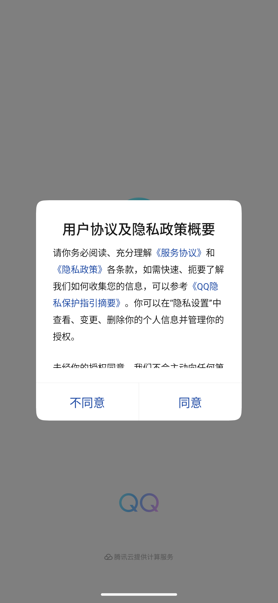
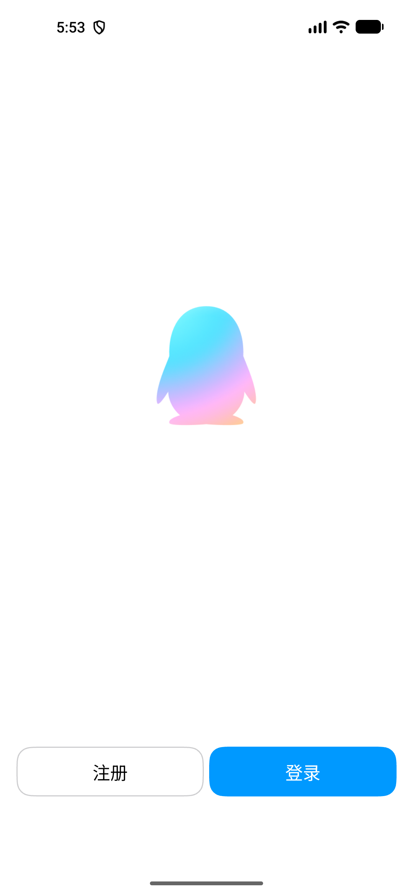
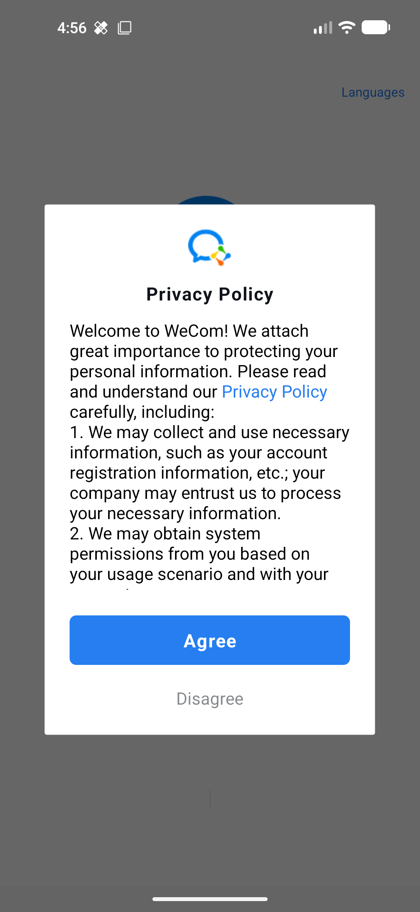
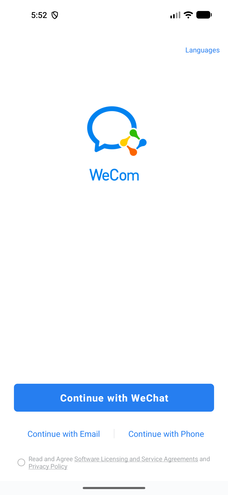
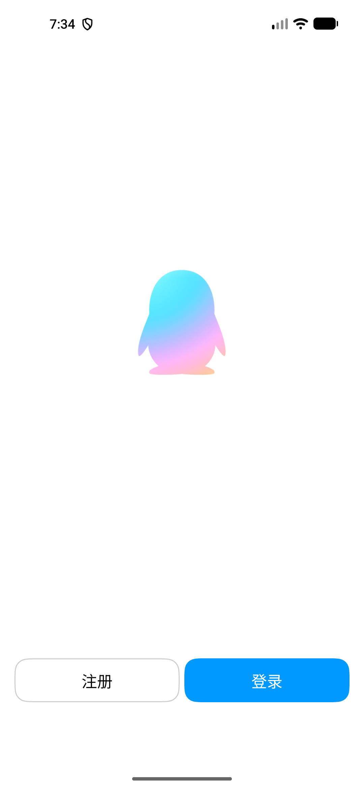
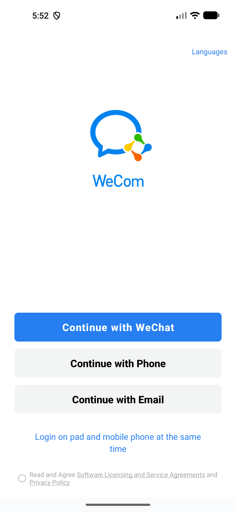

# QQ 与企微本地冒烟记录

> 历史实验记录：保留当时的观察和局限；现行自动验收使用 [ReDroid 运行环境](../environment/redroid-runtime.md)，本记录不代表当前通过状态。

日期：2026-10-09

## 环境

- AVD：`WeChatPad79LocalSmoke`，Android 17 / API 37.2，ARM64，16 KB page size。
- Root 与框架：Magisk 31.0、LSPosed 2.2.1 / API 102；仅在专用 AVD 上测试。
- QQ：本次安装 TabletHook 已验证的最低版本 9.3.35（versionCode 15560），包名 `com.tencent.mobileqq`；APK SHA-256：`db87781338cc31fd035a454591c8b435d96e4a65d7fc30d2f1068bc5433f3dbf`。测试前的 9.3.70.41925（versionCode 16410）备份在本机 `/tmp/qq-current-9.3.70.apk`，SHA-256：`e8c28713b740c18246989d47916d9fbbad06d440778a5aab3f4e108a2423e55c`。
- 企业微信：官方 Android APK 5.0.11.81206（versionCode 81206），包名 `com.tencent.wework`；APK SHA-256：`06dc85176a74084c4333c2f96fb00e3216693caaae5ff52aad731dcc7ec63c1e`。
- QQ 版本以 [QQ 官网移动版](https://im.qq.com/immobile/) 当前页面加载的动态配置为准；官网动态配置列出的 64 位版本为 9.3.70.41925。静态下载页显示的旧版本不作为当前版本依据。
- 未登录 QQ 或企微账号，不扫描二维码，不输入账号或凭据。

## 冒烟状态

| 应用 | 无模块基线 | 指定模块 | Hook 结果 |
| --- | --- | --- | --- |
| QQ 9.3.70.41925 | 无模块登录页已验证：显示“注册/登录”，没有平板登录入口 | TabletHook 1.0 已启用；此前仅在此版本验证过 Hook | Hook 成功。QQ `:MSF` 日志显示 DexKit 唯一识别到设备类型配置，并记录“QQ MSF 平板设备类型已启用” |
| QQ 9.3.35（15560） | 未单独建立无模块基线 | 从百度手机助手的历史版本条目下载；安装包内部元数据为 `com.tencent.mobileqq` / `9.3.35` / `15560`，与 9.3.70 的腾讯签名证书 SHA-256 相同：`ea6e97ad6c34f7039a9c6daba732c97d0e098e83ede2b4d52c76eb0184ac7a38`。重装后重新勾选 TabletHook→QQ scope | Hook 成功。重新启动后 QQ `:MSF` 日志再次显示 DexKit 候选唯一且“QQ MSF 平板设备类型已启用”；QQ 到达未登录的注册/登录页 |
| 企业微信 5.0.11.81206 | 无模块登录页已验证：显示微信、邮箱、手机登录选项，没有平板与手机同时登录入口 | 此前本地测试曾启用 WePadBridge 1.0.0，scope 为 `com.tencent.wework` | 此前 Hook 成功。LSPosed 日志记录主进程及 `:wemeet`、`:push`、`:wxa_container0` 的 hook applied successfully |

QQ 9.3.35 首次协议按用户已确认的授权点击“同意”；企微首次启动隐私政策由此前的本地冒烟自动化处理。两个应用都未登录，企微登录页上的软件许可复选框始终保持未勾选。

由于 AVD 空间不足以同时保留两个大版本，安装 9.3.35 前卸载了未登录的 9.3.70，应用本地数据随卸载清除；原 9.3.70 APK 已备份，可按需重装。

QQ 首次启动协议页基线（尚未同意）：



QQ 无模块登录基线（无平板入口）：



企微首次启动隐私政策页基线（尚未同意）：



企微无模块登录基线（无平板入口）：



QQ Hook 状态截图（未登录；登录页本身没有显示平板标记，Hook 生效由同一时间的 `:MSF` 日志确认）：



QQ 9.3.35 首次运行并同意协议后的登录页（未登录）：


企微 Hook 成功截图（未登录；页面显示“Login on pad and mobile phone at the same time”）：



## 设备兼容性备注

在 16 KB page size AVD 上，QQ 首次启动曾因 APK 内 `libc++_shared.so` 的 ELF 对齐为 8 KB 而无法加载。为本地测试临时设置 Android 16 KB backcompat 属性后，QQ 进入上述协议页并保持运行。2026-10-09 本次 AVD 重启后已重新设置并读回 `bionic.linker.16kb.app_compat.enabled=true`、`pm.16kb.app_compat.disabled=false`；再次重启后需要重设。这属于测试环境条件，不是 QQ Hook 结果。

## 结果

TabletHook 在 QQ `:MSF` 进程成功启用平板设备类型；WePadBridge 在企业微信登录页展示平板与手机同时登录入口。QQ 与企微都保持未登录，没有输入账号、触发认证或扫描二维码；企微登录页软件许可复选框未勾选。QQ 的界面没有平板标记，因此该项以模块运行日志作为 Hook 成功判据。

LSPosed 作用域配置读回：重装 QQ 后，LSPosed 自动移除了 QQ 关联的 TabletHook scope；重新勾选 QQ 后，数据库确认 TabletHook 对 `com.tencent.mobileqq` 的 scope 已恢复。WeChatPad 对 `com.tencent.mm` 保持启用；QQ 验证期间微信进程保持停止。TabletHook APK 的静态 scope 仍声明 `com.tencent.mm`、`com.tencent.mobileqq`、`com.xunmeng.pinduoduo`；拼多多未安装。I-Am-Pad 保持关闭。

本次从 LSPosed 模块日志 `/data/adb/lspd/log/modules_2026-10-09T17:03:25.705671.log` 读到的 TabletHook 记录（2026-10-09 19:33）：

```text
[2026-10-09T19:33:31.627] (com.tencent.mobileqq:MSF)[com.roro.tablethook,TabletHook] DexKit QQ 客户端配置类候选：1
[2026-10-09T19:33:35.463] (com.tencent.mobileqq:MSF)[com.roro.tablethook,TabletHook] DexKit QQ MSF 设备类型候选：Context布尔=3，Getter=1，最高引用=3，TABLET=1
[2026-10-09T19:33:35.467] (com.tencent.mobileqq:MSF)[com.roro.tablethook,TabletHook] QQ MSF 平板设备类型已启用
```

QQ 9.3.35 重装后恢复 TabletHook→QQ scope，并于 19:45 再次读取到成功记录：

```text
[2026-10-09T19:45:44.059] (com.tencent.mobileqq:MSF)[com.roro.tablethook,TabletHook] DexKit QQ 客户端配置类候选：1
[2026-10-09T19:45:46.664] (com.tencent.mobileqq:MSF)[com.roro.tablethook,TabletHook] DexKit QQ MSF 设备类型候选：Context布尔=3，Getter=1，最高引用=3，TABLET=1
[2026-10-09T19:45:46.668] (com.tencent.mobileqq:MSF)[com.roro.tablethook,TabletHook] QQ MSF 平板设备类型已启用
```

9.3.35 历史版本来自[百度手机助手版本条目](https://mobile.baidu.com/item?docid=5015700724&fromPage=fuchi)，条目显示 9.3.35、2026-08-12、395.67 MB；本地下载后进一步核验 APK 包名、版本名、versionCode 和腾讯签名证书。官网当前仍提供 9.3.70；该历史版本条目用于获取模块 README 指定的最低验证版本。

WePadBridge 重新启用后，在 17:52 读到以下记录：

```text
[2026-10-09T17:52:23.031] (com.tencent.wework)[com.wecom.padbridge] WePadBridge hooks applied successfully
[2026-10-09T17:52:28.716] (com.tencent.wework:wemeet)[com.wecom.padbridge] WePadBridge hooks applied successfully
[2026-10-09T17:52:34.125] (com.tencent.wework:push)[com.wecom.padbridge] WePadBridge hooks applied successfully
[2026-10-09T17:52:35.138] (com.tencent.wework:wxa_container0)[com.wecom.padbridge] WePadBridge hooks applied successfully
```

TabletHook 的 `staticScope=true` 和 `META-INF/xposed/scope.list` 固定声明微信、QQ、拼多多；LSPosed 页面确认该 scope 不可修改。用户已接受完整作用域，本次仅启动 QQ 进行验证。静态 scope 的语义见 [LSPosed API 文档](https://github.com/LSPosed/LSPosed/wiki/Develop-Xposed-Modules-Using-Modern-Xposed-API)。
